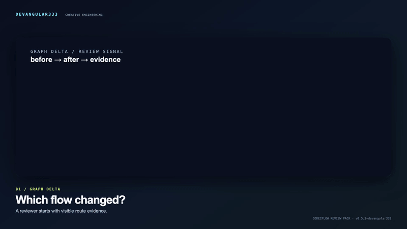
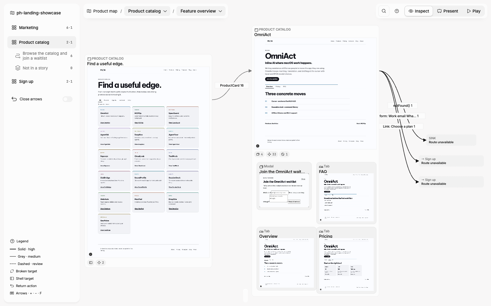
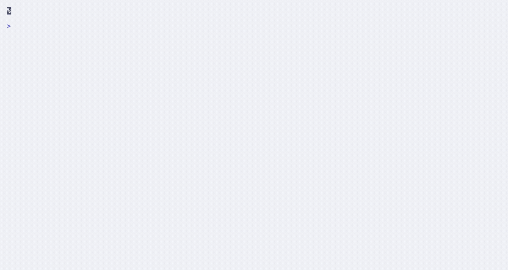
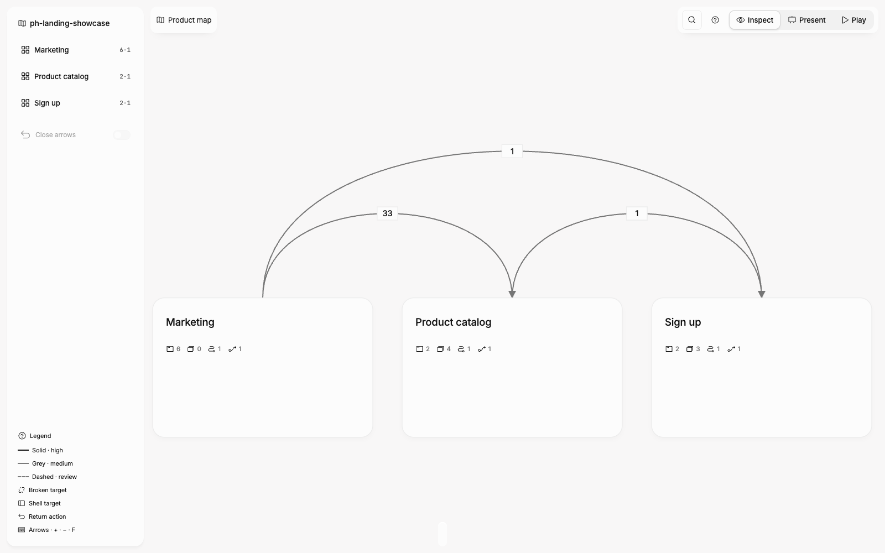
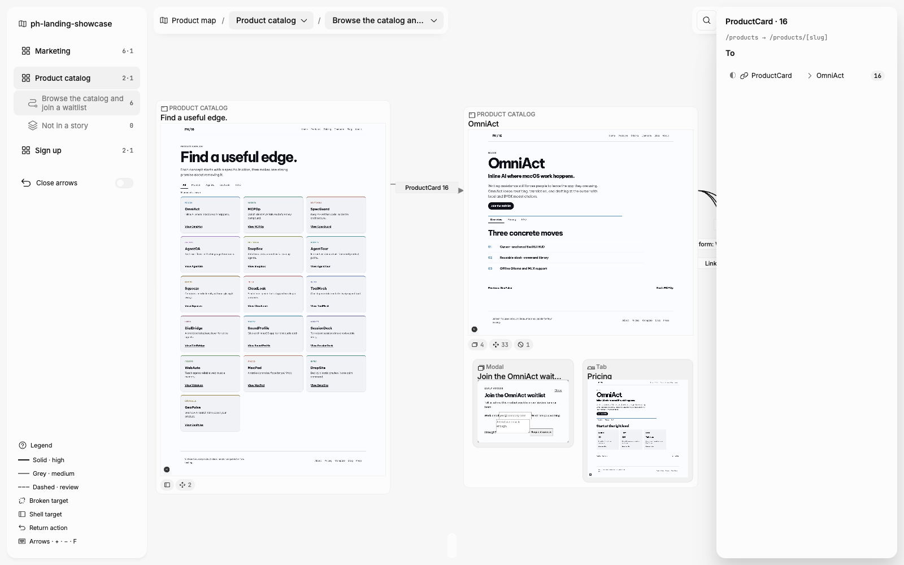
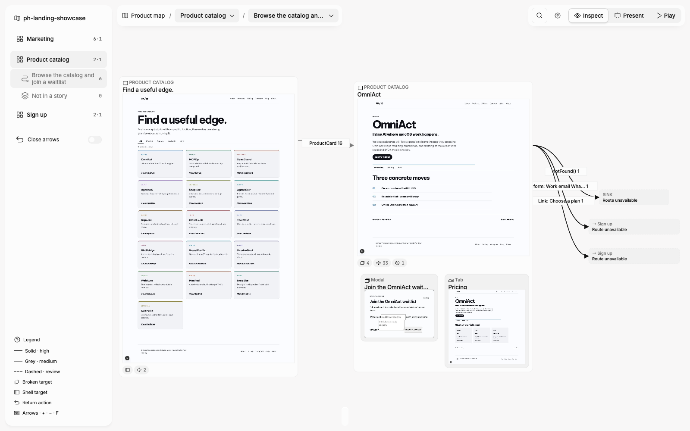
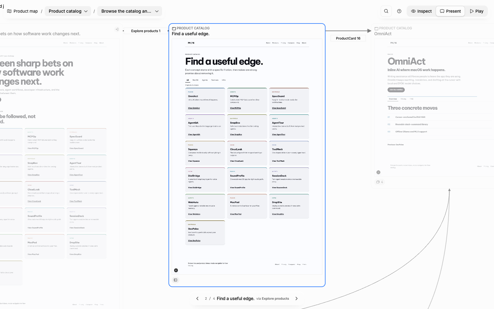
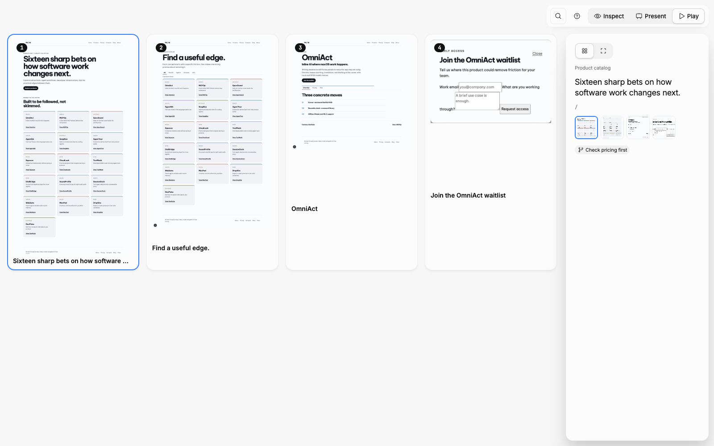
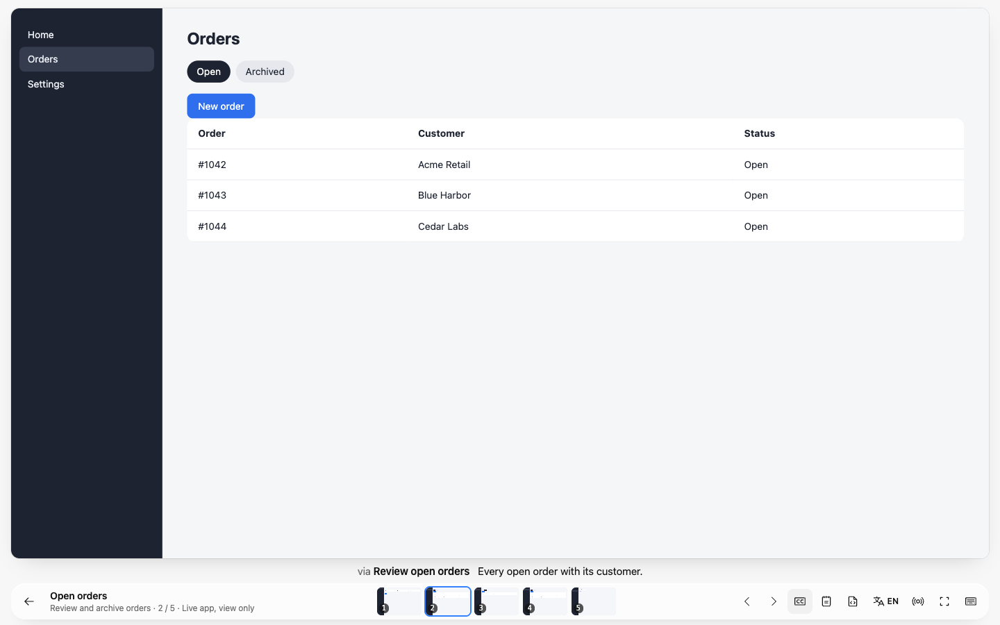
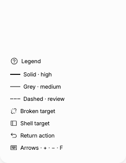

# Code2Flow

Turn a web codebase into a local, evidence-backed Flow Canvas your product team can explore. Every screen is a real screenshot, every arrow is an action found in the code with `file:line` evidence and a confidence tier. Nothing leaves your machine.

## DevAngular333 Review Pack

[](https://namaiengineer.github.io/devangular333-portfolio/#review-pack-video)

Watch the [58-second product video](https://github.com/NamAIEngineer/design-os-code/releases/download/v0.5.2-devangular333/code2flow-review-pack-launch-1080p.mp4) or open the [interactive demo](https://namaiengineer.github.io/devangular333-portfolio/review-pack-demo.html). The [poster](docs/assets/code2flow-review-pack-poster.png) remains available when a Markdown viewer does not play GIF/MP4 inline. The rerunnable [capture/render pipeline](docs/media-pipeline.md) stays local and keeps raw footage out of the public tree.

This release adds a reviewer workflow for a concrete question: **which screens
and transitions changed, and what should a person check in the running app?**
Give the CLI two graph revisions and optional focus terms. It writes a
self-contained HTML checklist plus JSON. Reviewers can mark each item `todo`,
`in-review`, or `verified`, add a note, and export the current review state.

```bash
npm ci
npm run build
npm run cli -- scan fixtures/review-pack/crm-v1
npm run cli -- scan fixtures/review-pack/crm-v2
npm run cli -- review fixtures/review-pack/crm-v2 \
  --from fixtures/review-pack/crm-v1/.code2flow/graph.json \
  --focus order,status \
  --before-label 'CRM v1 · synthetic' \
  --after-label 'CRM v2 · synthetic' \
  --before-ref fixtures/review-pack/crm-v1 \
  --after-ref fixtures/review-pack/crm-v2 \
  --out /tmp/code2flow-review
open /tmp/code2flow-review/review-pack.html
```

Try the [public interactive Review Pack demo](https://namaiengineer.github.io/devangular333-portfolio/review-pack-demo.html)
before installing. It uses the included **synthetic** CRM revisions: the new
order-status path is related to the focus terms, while a profile-settings
change stays unrelated. The browser report is local-only; it does not inspect
GitHub or upload target-repo files. The [sample app](fixtures/review-pack/README.md)
is a separate running-app check for the order-status button.

## DevAngular333 verified path

This public MIT repository adds a reproducible offline smoke command:

```bash
npm ci
npm run smoke
```

The command builds the viewer, scans a copied synthetic static HTML fixture with
the real CLI, checks the canonical graph, and exports a self-contained HTML flow
map in a temporary directory. It proves parser/export behavior only; it does
not claim screenshots or browser capture for an arbitrary target app. See the
[case study](docs/case-study.md) and [attribution](NOTICE.md).

Supported today: Next.js App Router, React Router (v6/v7), static HTML folders — see [adapters](docs/adapters.md).



## Install

```bash
git clone https://github.com/NamAIEngineer/design-os-code.git
cd design-os-code
npm ci
npm run build
node dist/cli/index.js --help
```

This is the DevAngular333 repository and release path. The upstream project is
credited in [`NOTICE.md`](NOTICE.md); no npm package is published from this
namespace.

Node 20+, Google Chrome, and the target app's development server are required.

## Quick start

```bash
node dist/cli/index.js init  /path/to/your-app    # config, .gitignore, AGENTS.md section, agent skills
node dist/cli/index.js run   /path/to/your-app    # dev server → scan → screenshots → lint → offline export
node dist/cli/index.js serve /path/to/your-app    # http://127.0.0.1:4317
```



Start with the **[user guide](docs/user-guide.md)** — install to hand-outs, step by step.

## What you get

**See the product map first.** Features and the transitions between them, before any single flow.



**Inspect what the code found.** Click a screen or an edge pill: trigger, target, confidence, `file:line` evidence.



**Recognize UI states.** Modals, tabs, drawers, dropdowns and hover overlays are frames of their own, on a tinted container next to their page.



**Present one story at a time.** A clean lane per story, keyboard stepping, both sidebars out of the way.



**Play every step.** Grid view shows every screenshot of a story in order; click a card to open the Stage on that step.



**Present live.** The Stage shows one story step at audience scale: the running app itself (view only, `E` to take control) when `serve` finds it on this machine, the captured screen otherwise and in every export. Captions, presenter notes (`N`), audience names and languages (`L`) come from the Story Manifest. One optional line in the app keeps stepping free of page reloads:

```ts
import { installStageBridge } from "design-os-code2flow/stage-bridge";
if (import.meta.env.DEV) installStageBridge({ navigate: (path) => router.navigate(path) });
```



**Keep the legend close.** The left rail holds features, stories and the arrow legend; every canvas icon explains itself on hover.



## Docs

- [User guide](docs/user-guide.md)
- [Getting started](docs/getting-started.md)
- [Configuration reference](docs/config-reference.md) — `code2flow.config.json` (incl. `stage`), `code2flow.stories.json` (v3 captions, notes, names, locales)
- [Ingestor adapters](docs/adapters.md)
- [Confidence tiers and capture policy](docs/confidence-and-capture.md)
- Decisions: [docs/adr/](docs/adr/)

For agents: skills `code2flow-map-codebase`, `code2flow-answer-flow-questions`, `code2flow-stories-from-prd` ship in the package and are copied into your repo by `code2flow init`.

## Develop

```bash
npm run cli -- scan fixtures/synthetic/app-router-basic   # run from source (tsx)
npx tsc --noEmit && npx vitest run                          # browser tests drive the installed Chrome
npm run recall                                              # parser vs hand-labelled ground truth
npm run audit:design                                        # design:os floors on a fixture export
```

Layout: `src/parser` (adapters → CanonicalFlowGraph), `src/snapshot` (Playwright capture), `src/lint`, `src/viewer` (vanilla TS + SVG), all sharing only `src/schema`.
